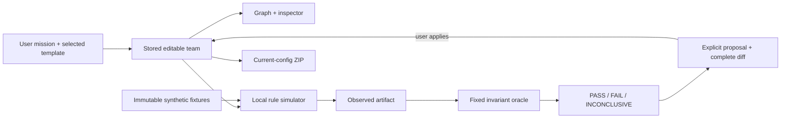

# Architecture

## V1.5 addition: manual Bridge
The existing template/simulation architecture remains intact. bridge-fixture.js holds a separately frozen source packet/oracle/rules; bridge.js prepares exact prompts, strictly parses untrusted JSON, checks bounded evidence, records raw provenance, gates manual handoffs and packages reproduction. bridge-ui.js stores its private records outside V1 localStorage state. No automatic Grok call, key or Bot API exists.

The mode switch/deep link (?mode=bridge) controls presentation. Every imported artifact has an explicit user-declared or Synthetic QA origin; origin is never authenticated from text. Client timestamps and SHA-256 hashes record provenance/integrity, not model/human authenticity. Additional unsupported semantics remain INCONCLUSIVE. Only matching PASS artifacts can prepare a next-role prompt; user submission is always manual.

The public source package uses an allowlist excluding historical browser dumps, private imports and backup bundles. Only curated product screenshots and bounded test fixtures are included. See GROK_BRIDGE_GUIDE.md and RELEASE_PREPARATION.md.

Dependency-free browser ES modules, native CSS, and a small Node development server. Public domain shapes are documented with JSDoc. This is intentionally a static local product; there is no server-side model, database or authentication.

## Modules

- `src/domain.js`: mission routing/templates, pure edits, shape validation and revision/fingerprint. A fingerprint detects stale proposals; it is not a cryptographic signature.
- `src/fixtures.js`: deeply frozen test inputs and expectations. User-editable policy cannot change the fixture's seven-day window or conflict expectation.
- `src/evaluator.js`: deterministic observed behavior, separate fixed oracle, proposals and stale-state protection. No source text is executed. Simulated approval failures never execute an external action.
- `src/state.js`: transitions, original baseline, reject/apply/revert, browser persistence. Stored scores are recomputed on reload; undo history and pending proposals are session-only.
- `src/export.js`: real current-config Markdown/JSON/schemas, actual export-time test results and ZIP STORE writer with CRC32. ZIP was independently opened by Python's standard zipfile after a real browser download.
- `src/adapter.js`: an explicit unconfigured boundary. Deployment throws rather than inventing a connection/API.
- `src/app.js` / `styles.css`: accessible semantic controls, escaped user text, SVG paths derived from stored routes, desktop/mobile layouts and reduced-motion support.

## Deliberately bounded evaluation

An enabled guardrail should make an unsafe fixture stop safely; that is PASS. A missing source cannot be recovered by a configuration toggle; it stays INCONCLUSIVE. The engine validates field/policy behavior, not arbitrary natural-language agent instructions. Exact synthetic checks are not a model benchmark, source-truth guarantee or security sandbox.

The first mission is the strongest fully designed vertical slice. Other templates/custom missions share these source/approval fixtures; real deployments need additional normal-flow and domain-specific fixtures. Forward acyclic handoff edits are allowed; users must review coverage if a route skips a role. No orchestration scheduler or live agent execution exists.

## Boundaries

No outbound model request, telemetry, public publishing implementation, secret or background automation. LocalStorage is a convenience, not protected secret storage. All user text is escaped before DOM interpolation; archived paths reject traversal. The local server serves only the app entry, source and public assets, not research files or Git metadata. Remote protections are not configured here.
