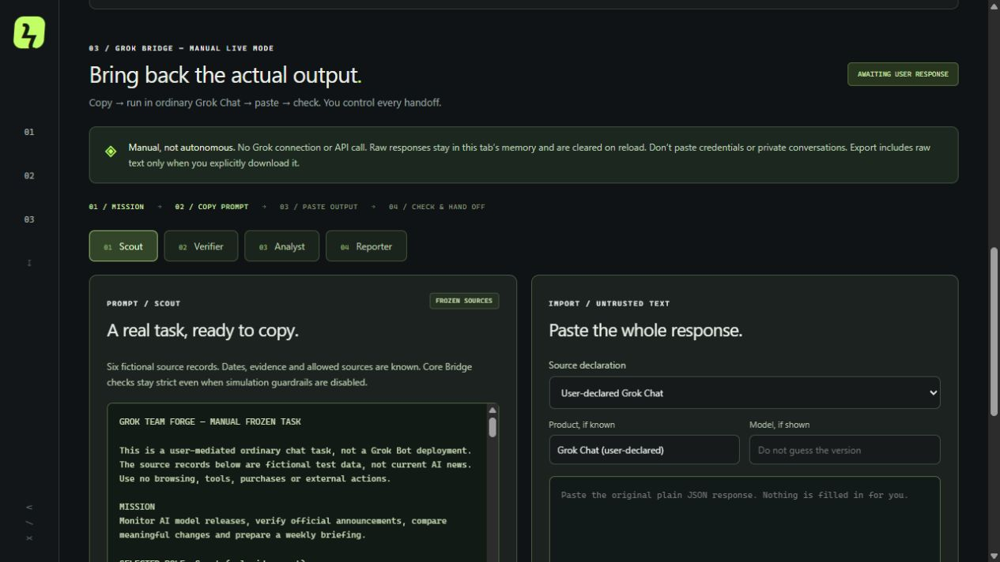

# Grok Team Forge

**Define an agent team. Test its handoffs. Keep the evidence.**

A deterministic workflow builder with editable roles, handoff contracts, synthetic stress tests and a **manual bridge to ordinary Grok Chat**. Built by @Velkrux. No API key or model request from the application.

**[Open the app](https://velkrux.github.io/grok-team-forge/)** · [Source repository](https://github.com/Velkrux/grok-team-forge)



## Try it locally

Requires Node 22 or newer. There are no dependencies to install.

Use **Code → Download ZIP** on this repository, extract it, and open a terminal in the extracted folder.

```sh
node server.mjs 4180
```

Open http://localhost:4180. [Five-step quickstart](QUICKSTART.md) · [Bridge guide](GROK_BRIDGE_GUIDE.md).

The public site was independently opened on 2026-10-24. [CI passed](https://github.com/Velkrux/grok-team-forge/actions/runs/40120341288) and [Pages deployed successfully](https://github.com/Velkrux/grok-team-forge/actions/runs/40120515454). See [verification scope and limitations](TEST_REPORT.md), including the hosted download-inspection limitation.

## Two modes

**Local Simulation:** choose a mission, inspect the generated deterministic role configuration, edit roles/routes, and run eight synthetic stress cases. Review an exact proposed diff, explicitly apply and rerun, reject or revert. These are configurable policy tests, not conversations between AI models.

**Real Grok Output / Manual Bridge:** prepare a role prompt, submit it yourself in ordinary Grok Chat, paste the full unedited output, declare its origin and inspect bounded checks. A matching PASS can prepare the next manual prompt. Export the original input/output, checks and reproduction script in an Evidence Kit.

The app provides three mission templates plus a custom keyword-routed configuration. The fixed factual Bridge evaluator currently supports the included fictional release-extraction task, not arbitrary research.

## A recorded experiment, with its limits

One supervised Scout request was completed in ordinary Grok Chat against six frozen fictional source records. The saved answer passed **47 bounded checks**, and its exported validation reproduced offline. Its approval remained `not_requested / draft_only`, with `actions: []`. A Verifier prompt was prepared; the Verifier was **not executed**.

The visible mode was Fast; the exact model version is unknown. This is one test case, not a model reliability score, benchmark or general security guarantee. Private raw transcripts, authenticated browser observations and evidence bundles are not included in this public source. [Experiment summary](docs/EXPERIMENT_SUMMARY.md).

## Privacy and boundaries

- The app makes no model API calls, installs no Bots, publishes nothing and runs no background agents.
- Pasted Bridge output stays in this tab's memory. Reload/clear removes app-held raw records. Team configuration is saved locally.
- Explicit Evidence Kit export includes raw text and client timestamps. Review it before sharing; browser/OS clipboard and downloads are separate storage.
- Origin is user-declared, not authenticated. A valid URL or hash does not prove truth, model origin or human approval.
- Unknown tasks/custom semantics can remain INCONCLUSIVE. The validator is bounded to known data; it is not a universal fact checker.

No native Grok Bot integration, autonomous multi-agent execution, model self-improvement or external action authority is provided. [Architecture](ARCHITECTURE.md) · [manual Bot setup reference](GROK_SETUP.md).

## Develop and verify

```sh
node --test tests/domain.test.mjs tests/bridge.test.mjs
node tools/build.mjs
node tools/verify-release.mjs
```

CI tests/builds pull requests and pushes to main. The separate Pages workflow is manually dispatched on main, checks the same commit, builds and uploads only the allowlisted `dist/` output, then deploys through the `github-pages` environment. [Deployment guide](PAGES_DEPLOYMENT.md) · [verification report](TEST_REPORT.md).

## License

MIT for original application code, fictional fixtures, documentation and our product screenshots. See [LICENSE](LICENSE) and [third-party notices](THIRD_PARTY_NOTICES.md). No music or video assets are part of the app/site payload.

Inspired by [the Grok Bot team guide](https://x.com/0xCodila/status/2090130749768786050); independently authored implementation and tests. Grok and xAI are their owners' marks. This is not an official xAI product.
